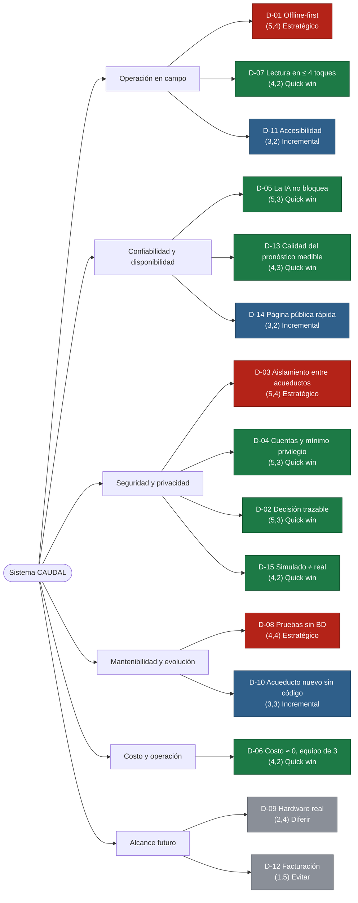

# Drivers arquitectónicos y árbol de utilidad

> Documento canónico de los drivers de CAUDAL: qué fuerzas moldean la arquitectura, cuánto pesa cada una y qué decisión la atiende. Las decisiones están en [`ADRs/`](ADRs/README.md) y su rastro hasta el código, en [`Trazabilidad-arquitectura.md`](Trazabilidad-arquitectura.md).
>
> Revisado el 2026-11-16 contra `develop` (`3c87ae3`).

## 1. Propósito y método

Un driver es un requisito que **obliga a decidir la estructura**: si cambia, cambia la arquitectura. No todos los requisitos lo son (los 82 RF y 28 RNF de [`Requerimientos.md`](Requerimientos.md) se resumen aquí en 15 drivers).

Se siguió el enfoque de un taller de atributos de calidad (QAW), adaptado a un equipo de tres personas:

1. **Fuentes.** Cada driver sale de un ID real: requisito no funcional (`RNF-xx`), historia de usuario (`HU-xx`), riesgo (`RG-xx` de [`Riesgos.md`](Riesgos.md)) o restricción del alcance ([`Caudal.md`](Caudal.md) §3).
2. **Escenario.** Cada driver se escribe como escenario de seis partes y se resume en una frase medible: **fuente** del estímulo → **estímulo** → **artefacto** → **entorno** → **respuesta** → **medida**.
3. **Priorización.** Se califica con dos escalas independientes:

| Valor | Importancia (para el producto) | Dificultad (técnica para este equipo) |
|---|---|---|
| 5 | Crítico: sin esto CAUDAL no sirve en la vereda | Muy alta: exige varias piezas nuevas o conocimiento que el equipo no tenía |
| 4 | Alto: el producto funciona, pero pierde confianza o uso | Alta: toca varias capas o repositorios |
| 3 | Medio: mejora clara, con alternativa manual | Media: una pieza nueva bien conocida |
| 2 | Bajo: se nota poco en el piloto | Baja: configuración o una clase |
| 1 | Mínimo: fuera del problema | Trivial |

4. **Cuadrantes.** Alta = 4–5; baja = 1–3.

| | Dificultad alta (4–5) | Dificultad baja (1–3) |
|---|---|---|
| **Importancia alta (4–5)** | **Estratégico**: decide la arquitectura; se diseña primero y con ADR | **Quick win**: se resuelve con tácticas conocidas; ADR corto |
| **Importancia baja (1–3)** | **Diferir / evitar**: se documenta y se deja una puerta abierta | **Incremental**: se atiende cuando toque, sin ADR propio si no hace falta |

## 2. Tabla de drivers

| ID | Driver | Fuente | Escenario medible | I | D | Cuadrante | Decisión (ADR) |
|---|---|---|---|---|---|---|---|
| D-01 | Operación sin señal (offline-first) | RNF-14, HU-09, HU-10, RG-01 | El fontanero registra una lectura **sin señal**; la app la guarda en IndexedDB con UUID del cliente y, al volver la red, la envía en lotes de **hasta 100**; un reenvío con el mismo UUID devuelve **la misma respuesta** sin duplicar (0 lecturas perdidas o duplicadas). | 5 | 4 | Estratégico | [ADR-007](ADRs/ADR-007-cola-offline-indexeddb.md), [ADR-005](ADRs/ADR-005-refresh-en-cookie-httponly.md) |
| D-02 | Decisión de la Junta trazable | RNF-19, HU-20, HU-21, HU-22, HU-37, RG-07 | La Junta aprueba, modifica o rechaza una propuesta; queda **una fila** en `audit.audit_log` con actor, acción y motivo, y ninguna fila *append-only* admite `UPDATE` ni `DELETE` con el rol `caudal_app` (intento → error de la BD). | 5 | 3 | Quick win | [ADR-004](ADRs/ADR-004-postgresql-18.md), [ADR-001](ADRs/ADR-001-monolito-modular-hexagonal.md) |
| D-03 | Aislamiento entre acueductos | RNF-07, RF-40, HU-04 | Un usuario del acueducto A pide un recurso del acueducto B, aunque el código olvide filtrar; la respuesta es **404** y la consulta directa a la tabla devuelve **0 filas** (RLS forzada con `app.aqueduct_id`). | 5 | 4 | Estratégico | [ADR-002](ADRs/ADR-002-aislamiento-con-rls.md) |
| D-04 | Seguridad de cuentas y mínimo privilegio | RNF-01, RNF-02, RNF-03, HU-01, HU-03, HU-05, RG-10 | Un atacante roba el token de acceso o reutiliza un refresh: el JWT expira en **15 min**; el reuso de un refresh rotado **revoca la familia** completa; 5 fallos de login en 15 min **bloquean** la cuenta; ninguna contraseña queda en claro (Argon2id m=19 MiB, t=2, p=1). | 5 | 3 | Quick win | [ADR-005](ADRs/ADR-005-refresh-en-cookie-httponly.md), [ADR-002](ADRs/ADR-002-aislamiento-con-rls.md) |
| D-05 | La IA nunca bloquea la operación | RNF-16, RF-16, HU-16, RG-03 | El servicio de IA está caído o dormido; el pronóstico responde con la **estimación simple** dentro del timeout (conexión **2 s**, lectura **10 s**); tras **5 fallos** el circuito se abre **60 s** y no se llama a la IA. | 5 | 3 | Quick win | [ADR-003](ADRs/ADR-003-pronostico-en-servicio-externo.md) |
| D-06 | Costo de operación cercano a cero y equipo pequeño | RNF-23, RG-11, RG-04, RG-13 | Todo el sistema corre en planes gratuitos (Render free 512 MB, Neon, Vercel) con **$0/mes**; la IA cabe en 512 MB (pico medido **334 MiB** con `chronos-bolt-tiny`); el equipo de **3 personas** opera **un** servicio Java. | 4 | 2 | Quick win | [ADR-001](ADRs/ADR-001-monolito-modular-hexagonal.md), [ADR-003](ADRs/ADR-003-pronostico-en-servicio-externo.md), [ADR-006](ADRs/ADR-006-simulador-como-proceso-separado.md) |
| D-07 | Registro de lectura en pocos toques | RNF-12, HU-09, RG-06 | El fontanero, en el tanque y con el celular, registra una lectura válida en **≤ 4 toques**, con objetivos táctiles de **48 px** (más que los 44 px del criterio) y el estado de conexión siempre visible. | 4 | 2 | Quick win | [ADR-007](ADRs/ADR-007-cola-offline-indexeddb.md) |
| D-08 | Mantenibilidad y pruebas sin base de datos | RNF-17, RNF-18, RNF-27, RG-08 | Un integrante cambia una regla de negocio; las pruebas del dominio corren **sin Spring ni BD**, las **11 reglas** de `ArchitectureTest` siguen en verde y la cobertura del dominio se mantiene **≥ 90 %**. | 4 | 4 | Estratégico | [ADR-001](ADRs/ADR-001-monolito-modular-hexagonal.md) |
| D-09 | Integración con hardware real | RNF-08, HU-34, HU-35, HU-36, RG-12 | Un sensor o válvula futura envía telemetría firmada (Ed25519, ventana **±300 s**, nonce único **10 min**) por la misma API que hoy usa el simulador, **sin cambiar el backend**. | 2 | 4 | Diferir | [ADR-006](ADRs/ADR-006-simulador-como-proceso-separado.md) |
| D-10 | Alta de un acueducto nuevo | RF-04, RF-40, RNF-07, `Datos-simulados.md` §10 | Una segunda vereda empieza a operar **solo con datos**: una fila en `org.aqueducts` (`is_demo = false`, hoy la inserta el operador porque no hay endpoint de alta) y sus usuarios y membresías por la API (`MembershipController`). Se mide en **0 migraciones** nuevas, **0 líneas** de código y **0 esquemas** adicionales. | 3 | 3 | Incremental | [ADR-002](ADRs/ADR-002-aislamiento-con-rls.md) |
| D-11 | Accesibilidad y bajo alfabetismo digital | RNF-13, RNF-12, RG-06 | Una persona con baja visión usa la PWA con teclado o lector; contraste **≥ 4,5:1**, información nunca solo por color y **0 violaciones** de axe en Playwright. | 3 | 2 | Incremental | Sin ADR estructural (táctica de UI; ver §6) |
| D-12 | Facturación y pagos | `Caudal.md` §3.2 ("Fuera del problema") | Una Junta pide cobrar el agua desde CAUDAL; el sistema **no lo ofrece** y la arquitectura no reserva piezas para ello. | 1 | 5 | Evitar | Ninguno, a propósito (ver §6) |
| D-13 | Calidad del pronóstico medible | RF-33, HU-33, RNF-28, RG-02 | El equipo compara la IA con la estimación simple sobre **≥ 30** evaluaciones con MAE, WQL, cobertura (meta **70–90 %**) y *skill* por horizonte; el veredicto (`helps` / `does_not_help`) sale de los números, no de la opinión. | 4 | 3 | Quick win | [ADR-003](ADRs/ADR-003-pronostico-en-servicio-externo.md), [ADR-006](ADRs/ADR-006-simulador-como-proceso-separado.md), [ADR-004](ADRs/ADR-004-postgresql-18.md) |
| D-14 | Página pública rápida y sin datos personales | RF-24, HU-24, RNF-15, RNF-20 | Una familia abre el horario publicado sin iniciar sesión; responde en **≤ 1 s** (p95, objetivo) y la respuesta contiene **0** nombres, teléfonos o IDs de usuario. | 3 | 2 | Incremental | Sin ADR propio: táctica `PublicScheduleProxy` dentro de [ADR-001](ADRs/ADR-001-monolito-modular-hexagonal.md) |
| D-15 | Datos simulados que nunca se confunden con reales | RNF-28, HU-39, HU-38, RG-14 | En el acueducto demo, **toda** pantalla, mensaje de WhatsApp, cartel y acta muestra "Datos simulados"; importar historial en un acueducto real responde **error** y no escribe nada. | 4 | 2 | Quick win | [ADR-006](ADRs/ADR-006-simulador-como-proceso-separado.md) |

## 3. Árbol de utilidad

Fuente editable: [`images/drivers-arbol.mmd`](images/drivers-arbol.mmd) (Mermaid). El mismo árbol, renderizable en GitHub:

Lectura del árbol: cada hoja es `(Importancia, Dificultad)`. Rojo = estratégico, verde = quick win, azul = incremental, gris = diferir o evitar.

## 4. Matriz de priorización

| | **Dificultad alta (4–5)** | **Dificultad baja (1–3)** |
|---|---|---|
| **Importancia alta (4–5)** | **Estratégico (3):** D-01 Offline-first · D-03 Aislamiento · D-08 Pruebas sin BD | **Quick win (7):** D-02 Trazabilidad · D-04 Cuentas · D-05 IA no bloquea · D-06 Costo · D-07 Pocos toques · D-13 Calidad del pronóstico · D-15 Simulado ≠ real |
| **Importancia baja (1–3)** | **Diferir / evitar (2):** D-09 Hardware real · D-12 Facturación | **Incremental (3):** D-10 Acueducto nuevo · D-11 Accesibilidad · D-14 Página pública |

| Cuadrante | Drivers | % del total (15) |
|---|---|---|
| Estratégico | 3 | 20 % |
| Quick win | 7 | 47 % |
| Incremental | 3 | 20 % |
| Diferir / evitar | 2 | 13 % |

Comprobaciones: **20 %** en alta importancia + alta dificultad (límite: 40 %); **4 de 4** cuadrantes ocupados; importancia de 1 a 5 y dificultad de 2 a 5, así que la escala sí separa.

Qué significa para el diseño:

- Los tres **estratégicos** son los que fijan la forma del sistema: la cola offline del cliente (D-01), la RLS en la base (D-03) y el hexágono con ArchUnit (D-08). Cada uno tiene su propio ADR con alternativas.
- Los **quick wins** se resuelven con tácticas conocidas (circuito y respaldo, cookie `HttpOnly`, tablas *append-only*), pero igual tienen ADR porque descartan opciones que un equipo podría tomar por defecto.
- **Diferir** no significa ignorar: D-09 queda abierto porque el simulador entra por las mismas puertas que el hardware (ADR-006). D-12 se **evita** a propósito: está fuera del problema.

## 5. Drivers → decisiones

| ADR | Decisión | Drivers que atiende |
|---|---|---|
| [ADR-001](ADRs/ADR-001-monolito-modular-hexagonal.md) | Monolito modular con arquitectura hexagonal | **D-08**, D-06, D-02, D-14 |
| [ADR-002](ADRs/ADR-002-aislamiento-con-rls.md) | Aislamiento multiacueducto con RLS forzada | **D-03**, D-04, D-10 |
| [ADR-003](ADRs/ADR-003-pronostico-en-servicio-externo.md) | Pronóstico en servicio externo con circuito y respaldo | **D-05**, D-06, D-13 |
| [ADR-004](ADRs/ADR-004-postgresql-18.md) | PostgreSQL 18 como única base de datos | **D-02**, D-03, D-13 |
| [ADR-005](ADRs/ADR-005-refresh-en-cookie-httponly.md) | Access token en memoria y refresh en cookie `HttpOnly` | **D-04**, D-01 |
| [ADR-006](ADRs/ADR-006-simulador-como-proceso-separado.md) | Simulador como proceso separado que usa la API pública | **D-15**, D-09, D-13, D-06 |
| [ADR-007](ADRs/ADR-007-cola-offline-indexeddb.md) | Cola offline en IndexedDB (Dexie) con reenvío idempotente | **D-01**, D-07 |

En negrita, el driver principal de cada ADR. Todos los drivers de importancia 4–5 (D-01 a D-08, D-13, D-15) tienen al menos un ADR, y todos los ADR tienen al menos un driver.

## 6. Drivers sin ADR (justificados)

| Driver | Por qué no tiene ADR | Dónde se atiende |
|---|---|---|
| D-11 Accesibilidad | Importancia 3: no cambia la estructura, sino los componentes de UI. No hay alternativas estructurales que descartar. | `caudal-frontend/.agents/ux-guidelines.md`, axe en Playwright (`caudal-frontend/e2e/`). |
| D-12 Facturación | Importancia 1: fuera del problema según `Caudal.md` §3.2. Diseñar para ello sería trabajo especulativo. | Ninguno, a propósito. Si cambia el alcance, se abre un ADR nuevo. |
| D-14 Página pública | Importancia 3: se resuelve con una táctica dentro del hexágono (`PublicScheduleProxy`, que quita los datos personales) y no con una decisión estructural propia. | `ADR-001` (adaptador de salida) y `RNF-20`. |

## 7. Cómo se mantiene

- **Entrada.** Un driver nuevo entra con su **fuente** (ID de RNF, HU, RG o restricción) y un **escenario medible**. Sin fuente o sin medida, no es un driver: es una opinión.
- **Revisión.** Al cerrar cada fase se revisan la importancia y la dificultad de todos los drivers, y se comprueba que el cuadrante estratégico siga en **≤ 40 %**.
- **Cambios.** Si cambia una prioridad, se agrega una fila a la bitácora con la fecha, el valor anterior, el nuevo y el motivo. Si el cambio mueve un driver de cuadrante, se revisa su ADR.
- **Trazabilidad.** Todo driver de importancia 4–5 debe tener un ADR y una fila en [`Trazabilidad-arquitectura.md`](Trazabilidad-arquitectura.md).

### Bitácora de cambios de prioridad

| Fecha | Driver | Antes | Después | Motivo |
|---|---|---|---|---|
| 2026-11-16 | Todos | — | Valores de la §2 | Versión inicial, derivada de `Requerimientos.md`, `Historias-de-usuario.md` y `Riesgos.md` en `develop` (`3c87ae3`). |

Relacionados: [ADRs](ADRs/README.md) · [Trazabilidad](Trazabilidad-arquitectura.md) · [Arquitectura](Arquitectura.md) · [Stack tecnológico](Stack-tecnologico.md) · [Riesgos](Riesgos.md)
